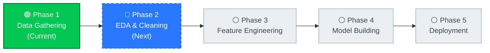
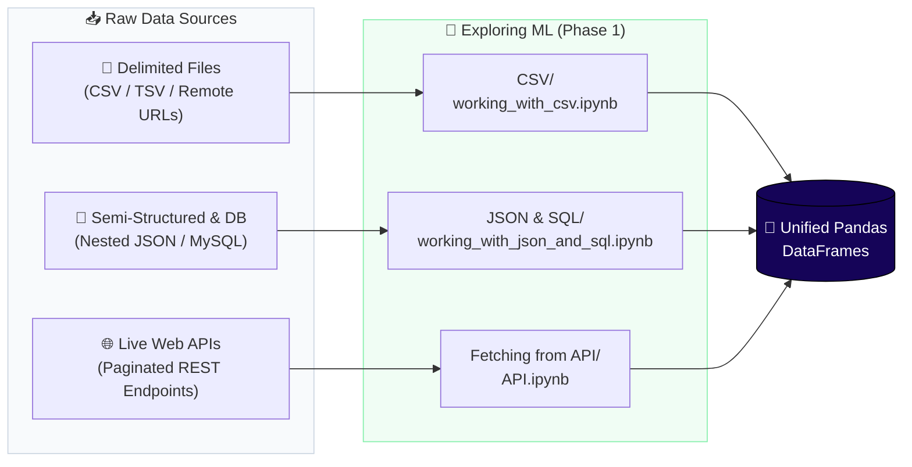

<div align="center">

# 🧠 Exploring ML

**A hands-on Machine Learning learning journey — documenting each stage of the ML lifecycle from raw data gathering to production models.**


[🗺️ Roadmap](#roadmap) • [🏛️ Architecture](#architecture) • [📂 Phase 1 Breakdown](#phase-1) • [🎯 Skills Covered](#skills)

</div>

---

<a id="roadmap"></a>
## 🗺️ ML Learning Roadmap

This repository grows sequentially as I progress through each stage of the Machine Learning lifecycle. Currently, I am in **Phase 1: Data Gathering & Ingestion**.



| Phase | Stage | Status | Focus |
| :---: | :--- | :---: | :--- |
| **1** | **Data Gathering & Ingestion** | 🔄 **In Progress** | Loading CSV/TSV, JSON, SQL databases, and REST APIs into Pandas |
| **2** | **EDA & Data Cleaning** | 📅 **Up Next** | Distributions, outliers, missing data, bivariate & multivariate analysis |
| **3** | **Feature Engineering** | ⏳ **Planned** | Scaling, encoding, feature transformation, dimensionality reduction |
| **4** | **Model Building & Evaluation** | ⏳ **Planned** | Supervised & unsupervised algorithms, cross-validation, tuning |
| **5** | **Deployment** | ⏳ **Planned** | Model serialization, API serving, and pipeline automation |

---

<a id="architecture"></a>
## 🏛️ Phase 1 Architecture — Data Gathering

In real-world ML, data rarely arrives as a clean table. **Phase 1** organizes ingestion into three practical data streams feeding into unified Pandas DataFrames:



---

<a id="phase-1"></a>
## 📂 Phase 1: Folder & File Breakdown

Click any expandable card below to inspect the exact parameters, concepts, and workflow inside each notebook.

### 1️⃣ `CSV/` — Delimited File Ingestion

📓 **Notebook:** [`CSV/working_with_csv.ipynb`](CSV/working_with_csv.ipynb)  
Focuses on handling real-world quirks in tabular text files—custom delimiters, missing headers, encoding errors, malformed rows, dates, and large-file memory management.

| File | Rows × Cols | Purpose in Learning |
| :--- | :---: | :--- |
| [`aug_train.csv`](CSV/aug_train.csv) | 19,158 × 14 | HR analytics data for practicing `index_col`, `usecols`, `dtype` downcasting, `na_values`, and `chunksize` |
| [`IPL Matches 2008-2020.csv`](CSV/IPL%20Matches%202008-2020.csv) | 816 × 17 | Sports match logs for `parse_dates` and in-flight value transformation via `converters` |
| [`movie_titles_metadata.tsv`](CSV/movie_titles_metadata.tsv) | 617 × 6 | Tab-separated file without headers for practicing `sep='\t'` and manual `names` |
| [`zomato.csv`](CSV/zomato.csv) | 9,551 × 21 | Global restaurant data with non-UTF-8 characters to fix `UnicodeDecodeError` (`encoding='latin-1'`) |
| [`student_placement.csv`](CSV/student_placement.csv) | 500 × 4 | Compact tabular dataset (IQ, CGPA, placement) for baseline ingestion checks |
| [`test.csv`](CSV/test.csv) | 5 × 15 | File with offset/blank leading lines to practice shifting headers with `header=1` |

<details>
<summary><b>🔍 Click to explore all <code>pd.read_csv()</code> techniques covered in this notebook</b></summary>

| Technique | Parameter | What It Solves |
| :--- | :--- | :--- |
| **Remote Loading** | `requests` + `StringIO` | Streaming CSVs directly from web URLs into memory |
| **Custom Delimiters** | `sep='\t'`, `names=[...]` | Reading TSV/semicolon files and assigning missing column names |
| **Primary Indexing** | `index_col='enrollee_id'` | Using an existing ID column instead of a redundant default index |
| **Header Alignment** | `header=1`, `skiprows` | Skipping leading metadata or corrupt rows before the table starts |
| **Column Filtering** | `usecols=[...]` | Loading only needed features to save RAM and disk I/O |
| **Encoding Fix** | `encoding='latin-1'` | Preventing UTF-8 decode crashes on international text |
| **Bad Line Handling** | `error_bad_lines=False` | Skipping malformed rows with uneven delimiter counts |
| **Memory Downcasting** | `dtype={'target': int}` | Overriding oversized default types on load |
| **Date Parsing** | `parse_dates=['date']` | Parsing string dates into native `datetime64` during read |
| **In-flight Transforms** | `converters={col: fn}` | Cleaning or standardizing values (e.g., team names) as rows load |
| **Custom Nulls** | `na_values=[...]` | Mapping custom placeholder strings to `NaN` |
| **Stream Chunking** | `chunksize=5000` | Iterating over huge files in batches to prevent Out-Of-Memory crashes |

</details>

---

### 2️⃣ `JSON & SQL/` — Semi-Structured & Relational Ingestion

📓 **Notebook:** [`JSON & SQL/working_with_json_and_sql.ipynb`](JSON%20%26%20SQL/working_with_json_and_sql.ipynb)  
Explores importing non-tabular JSON payloads and querying live relational databases directly into DataFrames.

| File | Size / Records | Purpose in Learning |
| :--- | :---: | :--- |
| [`train.json`](JSON%20%26%20SQL/train.json) | 39,774 records | Cooking recipes containing nested `ingredients` lists to practice hierarchical JSON loading |
| [`working_with_json_and_sql.ipynb`](JSON%20%26%20SQL/working_with_json_and_sql.ipynb) | Notebook | Combines local/live JSON parsing with MySQL database querying |

<details>
<summary><b>🔍 Click to explore the JSON &amp; SQL workflows covered</b></summary>

1. **Local JSON:** Reading multi-record JSON files with nested list fields (`train.json`) via `pd.read_json()`.
2. **Remote JSON Endpoints:** Fetching live API payloads (currency exchange rates) directly into a DataFrame.
3. **Relational SQL Databases:** Connecting to a local MySQL `world` database using `mysql.connector` and pulling SQL query results straight into Pandas with `pd.read_sql_query()`.

</details>

---

### 3️⃣ `Fetching from API/` — Web API Harvesting & Pagination

📓 **Notebook:** [`Fetching from API/API.ipynb`](Fetching%20from%20API/API.ipynb)  
Demonstrates building a programmatic data collector to harvest multi-page datasets from a live REST API.

| File | Records | Purpose in Learning |
| :--- | :---: | :--- |
| [`API.ipynb`](Fetching%20from%20API/API.ipynb) | Notebook | Fetches paginated cricket player profiles from CricAPI and merges batches |
| [`cric_ply.csv`](Fetching%20from%20API/cric_ply.csv) | 1,525 × 3 | Resulting dataset exported after harvesting and normalizing 60 API pages |

<details>
<summary><b>🔍 Click to explore the API harvesting pipeline</b></summary>

```text
.env (CRICAPI_KEY) ──► python-dotenv ──► Loop offset 0..59 ──► JSON['data'] ──► pd.concat() ──► cric_ply.csv
```

- **Credential Safety:** Keeps the API key out of code using `.env` and `os.getenv("CRICAPI_KEY")`.
- **Pagination:** Iterates across 60 offset pages to gather complete records beyond single-request limits.
- **Batch Merging:** Extracts the `data` payload from each JSON response, drops redundant ID columns, and concatenates batches into `cric_ply.csv`.

</details>

---

<a id="skills"></a>
## 🎯 Skills Mastered in Phase 1

- [x] Loading local and remote delimited files (`CSV`, `TSV`)
- [x] Fixing character encoding conflicts and skipping corrupted rows
- [x] Optimizing memory during read via `usecols`, `dtype`, and `chunksize`
- [x] Parsing dates and applying custom column `converters` on ingestion
- [x] Reading local nested `JSON` files and live JSON REST endpoints
- [x] Querying relational `MySQL` tables directly into Pandas DataFrames
- [x] Building paginated REST API harvesters with `.env` secret management
